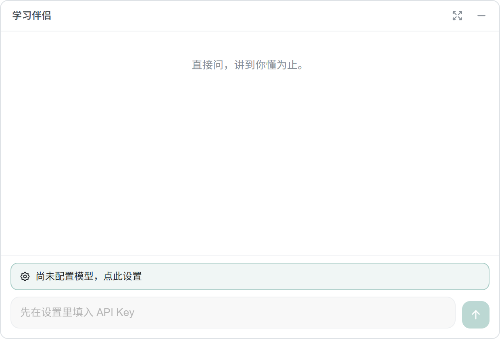
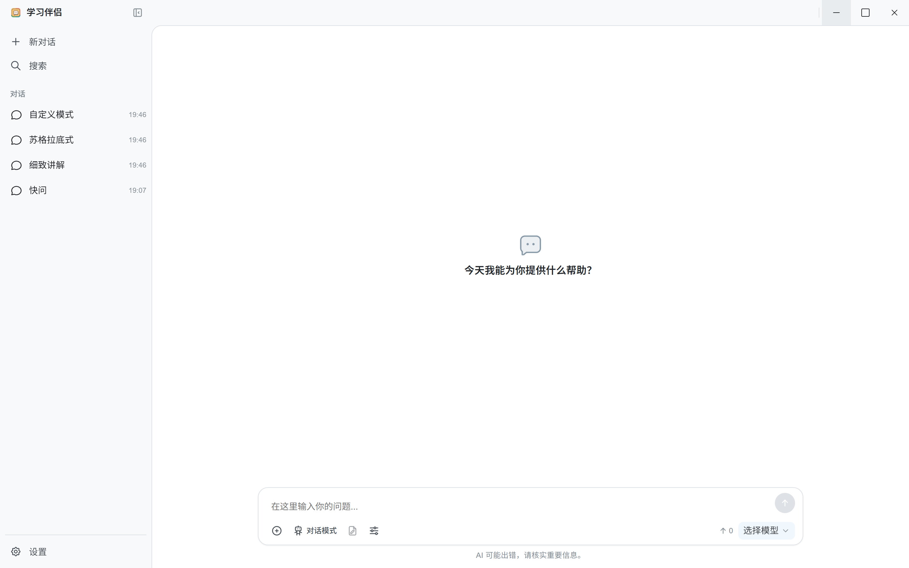

# 学习伴侣

Windows 11 上的本地优先学习助手：按 `Ctrl+Alt+Space` 呼出极简小窗，直接问；需要深入时展开主窗口，用学习模式把一个问题讲透。

本项目基于 [Chatbox Community Edition](https://github.com/chatboxai/chatbox) 改造，遵循 GPL-3.0。它不是 Chatbox 官方产品，也不包含 Chatbox 账号、会员或云端额度。

## 下载

从 [Releases](https://github.com/HomewardBird/study-companion/releases/latest) 下载 Windows x64 安装包。当前版本需要自备 API Key。





## 特点

- **快捷小窗**：默认 `Ctrl+Alt+Space`，只显示输入框和少量回答；可自由缩放，`Esc` 或失焦隐藏。
- **三种学习模式**：细致讲解、苏格拉底式、自定义模式。重点是把概念讲懂，不是刷题。
- **自带模型**：在设置里填写自己的 API Key，支持 OpenAI、DeepSeek、Claude、Gemini、OpenRouter、Ollama 等兼容服务。没有登录、会员和内置免费额度。
- **学习笔记导出**：把对话按“提问 / 讲解”整理成 Markdown，带 frontmatter，适合归档到 Obsidian 等工具。
- **联网搜索**：小窗底部的圆球按钮可开启。先在 **设置 → 联网搜索** 填入 Tavily API Key（有免费额度），回答会优先依据搜索结果并附来源链接；没有 Key 时会提示先配置。
- **本地数据**：会话、设置和笔记索引保存在本机，不经过本项目服务器。
- **开机静默启动**：开机后只驻留托盘，需要时按快捷键呼出小窗。
- **精简构建**：仅 Windows x64，中文/英文语言包，当前安装包约 95 MB。

## 使用

1. 安装后打开主窗口，进入 **设置 → 模型提供方**，选择服务商并填写 API Key（以及需要时的 Base URL）。
2. 在 **设置 → 模型** 里选择默认模型。
3. 需要联网搜索时，进入 **设置 → 联网搜索**，选择 Tavily 并粘贴 API Key；不填也能正常聊天。
4. 按 `Ctrl+Alt+Space` 呼出小窗；`Enter` 发送，`Shift+Enter` 换行，`Esc` 隐藏。点小窗左下角的圆球按钮开启联网搜索，回答下方会列出本次来源。
5. 小窗右上角可展开主窗口；主窗口里可以选择学习模式、管理会话和导出学习笔记。
6. 在 **设置 → 快捷键与启动** 中可以修改快捷键，以及开关“开机自动静默启动”。

默认快捷键和开机自启都可以在设置中调整。没有配置模型时，小窗会提示先完成模型设置。

### 学习模式

| 模式    | 适合场景                       |
| ----- | -------------------------- |
| 细致讲解  | 第一次学一个概念，需要定义、原因、推导和类比     |
| 苏格拉底式 | 想自己推出结论，通过追问、反例和分级提示学习     |
| 自定义模式 | 自己写讲解风格、节奏、详略和规则，之后按这套规则回答 |

## 数据位置

Windows 下应用数据默认位于：

```text
%APPDATA%\xyz.chatboxapp.ce
```

API Key、模型配置和本地会话都在这个目录内。清理该目录会重置应用数据；导出学习笔记前请先备份需要的会话。

## 开发

### 环境要求

| 项目 | 要求 |
| --- | --- |
| 系统 | Windows 11 x64 |
| Node.js | 22.13 – 22.x（不要用 Node 24） |
| pnpm | 10.17 或更高 |
| Git | 任意较新版本 |

仓库内的 `.node-version` 为 `v22.14.0`。如果你使用 nvm-windows，可以直接切换：

```powershell
nvm install 22.14.0
nvm use 22.14.0
```

### 安装依赖

```powershell
corepack enable
corepack prepare pnpm@10.33.0 --activate
pnpm install --frozen-lockfile
```

`postinstall` 会准备 Electron 运行时依赖。首次安装时间较长，属于正常现象。

### 开发与检查

```powershell
pnpm start        # 开发模式，热更新
pnpm check        # TypeScript 类型检查
pnpm test         # Vitest
pnpm lint         # Biome
```

### 构建

```powershell
pnpm build        # 只构建 main / preload / renderer
pnpm package      # 构建并打包，输出到 release/build
pnpm package:local # 构建并打包到 F:\Github\学习伴侣-build
```

`electron-builder.yml` 默认输出到 `release/build`。仓库里保留了 `package:local` 脚本，方便在本机把安装包直接生成到 `F:\Github\学习伴侣-build`。

构建前请先关闭正在运行的“学习伴侣”，否则 Windows 可能因为文件占用导致打包失败。

### 推荐开发插件

用 VS Code 打开仓库时，会根据 `.vscode/extensions.json` 提示安装以下插件：

| 插件 | 用途 |
| --- | --- |
| Biome (`biomejs.biome`) | 格式化与静态检查 |
| Tailwind CSS IntelliSense (`bradlc.vscode-tailwindcss`) | Tailwind 类名补全 |
| Vitest (`vitest.explorer`) | 在编辑器里运行测试 |
| EditorConfig (`EditorConfig.EditorConfig`) | 统一缩进与换行 |

仓库同时提供 `.editorconfig` 和 Biome 配置；保存时格式化使用 Biome。

### 目录结构

```text
src/
  main/       Electron 主进程：窗口、快捷键、托盘、自动启动、IPC
  preload/    安全桥接
  renderer/   React 界面；quick/ 为快捷小窗
  shared/     共享类型与工具
packages/     核心业务、UI、国际化等 workspace 包
assets/       图标与安装器资源
docs/         截图与项目文档
```

## 已知限制

- 打包目标目前只有 Windows x64；macOS/Linux 配置保留自上游，但未针对本项目验证。
- 默认关闭自动更新，避免连接到上游更新服务。需要时设置环境变量 `CHATBOX_ENABLE_UPDATER=1`。
- 不内置模型，也不提供免费额度；需要自备 API Key，或连接 Ollama 等本地服务。
- 联网搜索使用第三方 Tavily，需要自备 API Key，免费额度有限；搜索失败或结果不足时会回退为普通回答，并提示“未核实”。
- Electron 安装包体积和内存有基础下限；当前已删除 source map、多余语言包和部分依赖，进一步显著压缩需要更换桌面壳。
- 学习笔记导出是把当前对话整理成 Markdown，不会自动生成完整的知识图谱；结构化程度取决于所用模型和学习模式提示词。

## 上游与许可证

本项目是 Chatbox Community Edition 的修改版：

- 上游：<https://github.com/chatboxai/chatbox>
- 许可证：GNU GPL v3，见 [LICENSE](LICENSE)
- 修改说明与上游版权信息：见 [NOTICE.md](NOTICE.md)

如果你分发本项目的修改版，需要继续遵循 GPL-3.0，并提供对应源代码。
